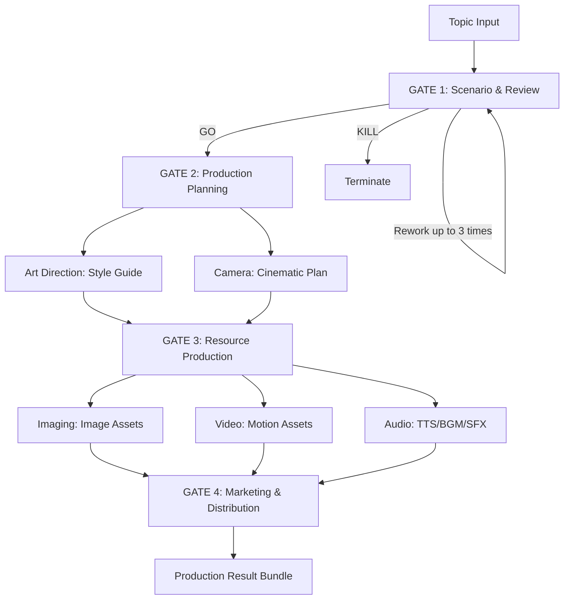

## 2026-11-24 — GPT형 Murim Director 단일 제작 UI (초기 인간매개)

`/studio/simple/`에서 프로젝트 생성·조회·이름 변경·보관/복원 → 기존 G1/G2 사전 시나리오 심사·승인 → GPT 이미지 후보 등록·선정 → 스토리보드 확정/M-VML 이미지 트랙 연결 → 장면별 영상 프롬프트·실제 영상 후보 등록을 수행한다. 미검증 GPT 이미지 자동 호출, LTX 다중 키프레임 자동 연결, 무인 품질 검증은 **차단/NOT_VERIFIED**이며 기존 `/studio/` 워크플로우를 변경하지 않았다. 설명: [Director 초도 UI 실행·검증 경계](docs/DIRECTOR_SIMPLE_UI_20261124.md).

## GPT-SoVITS v2 한국어 TTS 요청/반환 — 세션 간 공용 문서 (2026-11-23)

기존 로컬 GPT-SoVITS에 한국어 텍스트·속도·Temperature를 전달하여 WAV를 **직접 생성**하거나 Studio **장면 음성으로 등록**하는 정확한 명령/JSON/모델/파일/오류 경로: [GPT-SoVITS v2 TTS 요청·실행·반환 운영 설명서](docs/GPT_SOVITS_V2_TTS_OPERATIONS.md). 이 문서를 다른 세션의 TTS 작업 SSOT로 읽는다. 기존 모델/참조 WAV와 소스는 변경하지 않는다.

## 2026-11-22 — 콘텐츠 생산 품질 복구 (G1/G2 내부 우선)

영상 제작이나 외부 Gemini의 전면 재집필보다 **내부 감독/작가/리서치/Council의 작품 완성**을 우선한다. [Editorial Master](docs/skills/EDITORIAL_MASTER_SKILL_V2.md) · [사료 진실성](docs/skills/SOURCE_TRUTH_SKILL_V2.md) · [서사](docs/skills/CINEMATIC_NARRATIVE_SKILL_V2.md) · [독립 반대심사](docs/skills/INTERNAL_RED_TEAM_SKILL_V2.md)을 새 역사서사 전용 스킬로 구분하고, 기존 무협 강제 규칙을 분리했다. [시각 서사 스킬](docs/skills/CULTURAL_VISUAL_DRAMATURGY_SKILL_V1.md) / [세한도 내부 품질 실패 원장](docs/production/SEHANDO_INTERNAL_QUALITY_REMEDIATION_V1.md) / [v0.3 집필 지시](docs/production/SEHANDO_V03_EDITORIAL_ASSIGNMENT.md). 기존 4-GATE 최종 제품 실물 검증 유지. 레거시 mock 자동영상 생산 경로는 기본 HOLD이며, 스킬 등록을 작품 품질 PASS로 오인하지 않는다. 외부 원문 수정은 감독이 승인한 범위에만 국한한다.

## 사전 제작 우선 — 2026-11-22

작품을 열면 00A 원문 비교·확정, 00B 확정본 이력, 00C 제작 연결·승인이 먼저 열린다. 불합격 기획·미해결 비평·미평가 상태에서는 실제 생성/렌더 불가. 승인된 수정안만 기존 6단계 제작에 전달. 세한도 기존 실패 작품은 다시 가져오지 말고 저장된 작품을 열어 원문과 외부 수정 원문 비교 및 최종 문서 확정부터 시작한다. [사전 제작 UI 사용설명서](docs/PREPRODUCTION_STUDIO_GUIDE.md). 이전 README의 렌더 및 GPU 검증 지시는 사전 제작 승인 이후 적용한다.

## 통합 제작 Studio — 2026-11-22 첫 실행 검증 후보

Windows에서 `run-studio.cmd` (이번 추가 실행 진입점)을 실행하면 기존 Web UI가 localhost:8080에 열립니다. 브라우저 http://127.0.0.1:8080/studio/ 에서 세한도 기존 정상 run을 선택하고 '기존 작품 불러오기' 또는 새 작품을 생성합니다. 이미 실행 중인 Web UI는 정상 종료 후 한 번 재시작해야 새 route가 로드됩니다. 기존 Python/Flask/Pillow/FFmpeg 설치를 사용하고 자동 설치하지 않습니다.

6단계 탭(대본·장면 / 제작 자원 / 성우·음향 / 동작·영상 / 멀티트랙 / 렌더·심사), 동일 M-VML 리비전 저장, 장면/7트랙 CRUD, 실제 이미지·영상·음원 import, 제한 문장 자연어 patch와 외부 LLM 수동 전달, 기존 GPT-SoVITS v2 호출, 선택 컷/전체 FFmpeg 렌더 및 기존·캐시 클립 해시 재사용, 외부 심사 원문 저장. 모든 신규 결과는 outputs/studio/<project-id>/, 원본 v0.2 그대로. 초기 편집은 장면당 트랙별 슬롯(독립 다중 겹침·자유 드래그 NLE는 미구현). 기존 ComfyUI 연결: 동작·영상 탭에서 신뢰된 기존 API-format JSON 그래프를 등록하고 이미지·음성·동작 입력 및 출력 노드를 선택할 수 있습니다. 실행 중인 로컬 8188 서버를 사용하여 실제 저장 영상을 후보로 등록하는 연결부가 구현됐지만 해당 사용자 성공 그래프 및 GPU 실증은 아직 미검증입니다. 실제 Windows UI, GPU TTS, 사용자의 작품 재렌더 전에는 검증 완료/작품 승인 아님.

# Murim AI Content Factory 🏯

## 현재 우선순위: ComfyUI 실제 한 컷 생성 검증 (2026-11-21)

주기적 GitHub 자동 동기화·예약 작업은 **보류**한다. 먼저 WAN 2.2 워크플로로 **실제 비디오 한 컷**이 생성되는지 확인한다. GitHub 소스는 에이전트가 수정하고, Windows는 필요할 때 한 번 Pull하고 검증한다.

Windows PowerShell (처음 한 번 기존 예약 작업 사용 중지):

```powershell
Disable-ScheduledTask -TaskName 'Murim-GitHub-Sync-Test'
git -C 'E:\gpt\projects\comfyui\murim' pull --ff-only origin main
& 'E:\gpt\projects\comfyui\murim\run-comfyui-proof.cmd'
```

run-comfyui-proof.cmd는 **예약/반복 없이** 의존성 없는 Python 단위 검증을 수행한 다음, 로컬 ComfyUI http://127.0.0.1:8188에 접속해 WAN 2.2 모델·노드를 확인한다. 준비되었을 때만 임시 테스트 이미지를 업로드하고 **한 컷 생성 → 결과 확인 → 출력 파일 다운로드**까지 실행한다. 로컬 파일은 outputs/p1_comfyui/에 보존한다. 경로를 지정하면 run-comfyui-proof.cmd --image "C:\path\image.png"으로 입력 이미지를 교체할 수 있다. 준비 상태만 보려면 --probe-only를 사용한다.

필수 모델: wan2.2_ti2v_5B_fp16.safetensors, umt5_xxl_fp8_e4m3fn_scaled.safetensors, wan2.2_vae.safetensors; 워크플로의 Wan22ImageToVideoLatent, CreateVideo, SaveVideo 노드 필요. 없으면 명확히 실패하고 생성 요청을 보내지 않는다. 빈 workflows/ltx2_i2v_api.json은 시험 대상이 아니다.

이 검증은 17프레임/512×320/8 스텝의 **기능 가능성 확인**이지 영상 품질이나 전체 콘텐츠 제작 성공을 의미하지 않는다.


AI 기술을 활용한 정통무협 유튜브 콘텐츠의 완전 자동화 제작 시스템입니다.

## 🚀 개요
이 프로젝트는 시나리오 작성, 이미지 및 영상 생성, 성우 더빙, 그리고 최종 영상 편집까지의 전 과정을 멀티 에이전트 시스템을 통해 자동화하는 것을 목표로 합니다.

## 🛠 주요 기능
- **멀티 에이전트 파이프라인**: 작가, 비평위원회, 감독 에이전트 간의 협업
- **캐릭터 일관성 유지**: Midjourney --cref 및 --oref 기반 비주얼 생성
- **다국어 자동 확장**: 하나의 대본으로 5개국어 이상의 나레이션 및 자막 자동 생성
- **GATE 검증 시스템**: 제작 단계별 휴먼-인-더-루프(Human-in-the-loop) 품질 검증

## 🏗 System Architecture (4-GATE Pipeline)
시스템은 감독(Director) 에이전트의 주도하에 4단계 품질 검증 및 제작 과정을 거칩니다.



1. **GATE 1: Scenario & Review**: 작가가 시나리오를 집필하고 6인 비평위원회가 평가합니다. 기준 점수 미달 시 최대 3회 자동 수정을 거칩니다.
2. **GATE 2: Production Planning**: 미술 감독과 카메라 감독이 세계관 스타일 가이드 및 장면별 연출 계획을 수립합니다.
3. **GATE 3: Resource Production**: 비주얼(이미징), 모션(비디오), 사운드 에이전트가 연출 계획에 맞춰 리소스를 생성합니다.
4. **GATE 4: Marketing & Distribution**: 마케팅 에이전트가 제목, 요약, 태그 등 배포용 자산을 생성합니다.

## 🤖 Agents
- **Director**: 전체 공정 오케스트레이션 및 시스템 밸런스 유지
- **Writer**: 시나리오 집필 및 자가 수정
- **Council**: 6가지 페르소나를 가진 비평 위원회
- **Imaging**: 프롬프트 엔지니어링 및 일관성 있는 비주얼 생성
- **Video**: 이미지 기반 고퀄리티 모션 영상 생성
- **Audio**: 나레이션(TTS), BGM 작곡, SFX 효과음 생성
- **Camera**: 시네마틱 카메라 기획 및 연출 설계
- **Art Direction**: 세계관 스타일 가이드 및 시각적 정체성 정의
- **Marketing**: SEO 최적화 및 바이럴 마케팅 자산 생성

## 📦 설치 방법
1. 저장소 클론:
   ```bash
   git clone https://github.com/hoonoh57/murim.git
   cd murim
   ```
2. 환경 설정:
   ```bash
   cp .env.example .env
   # .env 파일에 API 키 입력
   ```
3. 라이브러리 설치:
   ```bash
   pip install -r requirements.txt
   ```

## 🎮 실행 방법

### 1. Human-Relay Web UI (추천)
API 비용 없이 Claude와 대화하며 단계별로 제작하는 방식입니다.
```bash
python web_ui.py
```
접속 주소: `http://localhost:8080`

### 2. CLI 자동화 모드
에이전트들이 설정된 API를 통해 자동으로 제작을 시뮬레이션합니다.
```bash
python main.py
```

## 🗺 로드맵
- **Phase 0**: 인프라 및 리포 정리 (완료)
- **Phase 1**: 핵심 에이전트 및 자가 진화 루프 구현 (완료)
- **Phase 2**: 4-GATE 통합 프로덕션 파이프라인 및 Web UI (완료)
- **Phase 3**: 다국어 채널 업로드 및 리얼 API 연동 고도화 (진행 중)

# ComfyUI API 워크플로우 파일

이 폴더에는 ComfyUI API 형식의 워크플로우 JSON 파일을 저장합니다.

## 파일 생성 방법

1. ComfyUI 웹 UI 접속 (http://127.0.0.1:8188)
2. 원하는 워크플로우를 로드/구성
3. Settings → **Enable Dev Mode Options** 켜기
4. 메뉴 → **Save (API Format)** 클릭
5. 이 폴더에 아래 이름으로 저장

## 필요한 파일

| 파일명 | 설명 |
|--------|------|
| `wan22_5b_api.json` | WAN 2.2 TI2V 5B I2V 워크플로우 |
| `ltx2_i2v_api.json` | LTX-2 Distilled FP8 I2V 워크플로우 |

---

## ComfyUI 기반 콘텐츠 자동화 완성 계획 (2026-11-21 기준)

이 섹션은 **기존 Murim AI Content Factory를 대체하지 않고 확장**하는 개발 계약이다. 기존 4-GATE/Director/Writer/Council/Imaging/Video/Audio/Camera/Art Direction/Marketing, Human-Relay Web UI, 에셋 대시보드, `workflows/wan22_5b_api.json`, `workflows/ltx2_i2v_api.json`, 렌더러와 테스트를 유지하며 ComfyUI를 실제 제작 백엔드로 점진적으로 연결한다.

### 원본과 Windows 실행 역할

- **개발 SSOT:** [`hoonoh57/murim`](https://github.com/hoonoh57/murim)의 `main` 브랜치. 모든 소스·문서·워크플로 CRUD, 검토, 수정, 정적/모의 검증 및 오류 복구는 GitHub 원본에서 수행한다.
- **Windows 소비/검증 작업공간:** `E:\gpt\projects\comfyui\murim`. Windows는 소스 작성자가 아니라 **GitHub fast-forward 동기화 + 실제 ComfyUI/GPU/영상·UI 검증 실행기**다. 이 경로가 실제로 저장소에 연결되었는지, runner에서 접근 가능한지는 Windows에서 별도 확인해야 한다.
- **반복 인증·Actions 금지:** 각 파일·micro-tranche마다 GitHub Actions 실행, 수동 push/pull·승인을 요구하지 않는다. 관련 변경은 GitHub에서 연속 처리하고 필요한 최종 실제 Windows 테스트만 한 번 요청한다.
- **동기화 방식:** `windows-test.cmd`가 `scripts/windows-sync-test.ps1`을 호출하여, clean 상태·정확한 원격·`main` 확인 후 `fetch` + `merge --ff-only`로 GitHub 변경을 로컬에 자동 반영하고 테스트한다. 로컬 사용자 변경과 비밀·산출물이 충돌하면 **자동 덮어쓰기 대신 중단**한다. 강제 reset/clean/삭제는 금지한다.
- **실제 실행 구분:** 저장소 커밋/자동 테스트 통과는 Windows에서 ComfyUI로 영상이 만들어진 사실이나 자동 동기화 스케줄이 실제 등록되었다는 증거가 아니다. 설치·실행 결과는 `docs/CURRENT_STATE.md`에 별도로 기록한다.

### 최종 제작 파이프라인

```text
시리즈 바이블/주제
    → GATE 1: Writer + 6인 Council + Director (시나리오 승인)
    → GATE 2: Art Direction + Camera (캐릭터/장면/샷리스트 확정)
    → GATE 3: Imaging/ComfyUI → Video/ComfyUI → Audio/TTS/BGM/SFX
    → 자막 동기화·편집·인코딩·품질 검사
    → GATE 4: Marketing (썸네일/제목/설명/태그/배포 패키지)
    → 사람의 최종 검수·게시 승인
    → 채널 공식 API 업로드(승인 후) → 이력/성과 추적
```

**필수 보장:** 콘텐츠·캐릭터 일관성, 장면별 워크플로·모델·시드·프롬프트 이력, 재시도 가능한 작업 큐, GPU/시간·비용 제한, 중복 렌더/게시 방지, 영상·자막·내레이션 싱크. 승인 없는 외부 게시는 하지 않는다.

### 단계별 개발 경계와 실제 합격 조건

| 단계 | 범위 | 실제 완료 판정 |
|---|---|---|
| **P0. 원본·환경 실사** | 현행 4-GATE/웹 UI/렌더러/테스트 현황, 로컬 원격·HEAD·사용자 변경, ComfyUI 버전·GPU/VRAM·노드/모델 확인 | 현재 상태/제약/안전한 동기화 경로 확인 |
| **P1. ComfyUI API 단일 컷** | 기존 `workflows/` API JSON을 재사용해 1장면 큐 제출·상태·결과·실패 추적 | 실제 Windows ComfyUI API 호출로 검증된 자산 1건 |
| **P2. 캐릭터·영상 일관성** | 캐릭터 기준 시트와 스타일/세계관 앵커, 6~10장면 이미지→영상 연결 | 동일 인물·무기·의상 연속성 검수 |
| **P3. 에피소드 완성본** | 기존 TTS/FFmpeg 렌더러 연결, 길이·자막·음성·음량·해상도 검수 | 실제 재생 가능한 MP4 1편과 제작 메타데이터 |
| **P4. 전 과정 복구형 자동화** | 4-GATE 작업 큐, 영속 상태, 체크포인트, 중단 후 재개, 휴먼 승인 | 재시도/취소/오류 복구·승인 게이트 검증 |
| **P5. 반복 생산 최적화** | 10편 연속, 품질·성능·GPU 사용량·비용 실측, 실패 유형 분석 | 10편의 독립적인 영상/검수/로그 증거 |
| **P6. 배포/성과** | 플랫폼별 출력, 공식 업로드 API, 승인·게시 ID/중복 방지, 성과 기록 | 승인된 1편 게시와 중복 방지 실증 |

숏폼 9:16 및 16:9 장편은 프리셋으로 확장하되, 실제 모델/VRAM 성능 검증 전 속도나 완성 시간을 확정하지 않는다. 기존 문서의 “완료” 표시는 과거 구현 기록이며 **현재 PC 실제 제품 PASS를 의미하지 않는다**.

### 현재 확인된 근거와 다음 작업

- GitHub에 기존 `main.py`, `web_ui.py`, `render_episode.py`, `tests/`, 2개 ComfyUI API 워크플로가 존재한다.
- 이 문서 작업에서는 **Windows의 실제 ComfyUI 연결, 영상 생성, 웹 UI, Git 동기화 및 예약 실행을 수행하지 않았다.**
- **다음 한 단계:** Windows 실행기가 위 작업공간을 읽을 수 있는지와 기존 Git 원격/변경 상태를 안전하게 확인한 다음, **실제 P1 ComfyUI 한 장면 API 작업**을 통과시킨다.
- 영속 상태/세션 인계: [`docs/CURRENT_STATE.md`](docs/CURRENT_STATE.md), [`docs/SESSION_HANDOFF.md`](docs/SESSION_HANDOFF.md), 원격 개발 헌법: [`AGENTS.md`](AGENTS.md).

### 영상 품질을 평가할 때 (실제 참조 PNG 필수)

기본 `run-comfyui-proof.cmd`는 인위적인 산·하늘 PNG를 넣는 **GPU/API 연결용 smoke test**다. 결과 영상의 품질을 평가하지 않는다. 실제 인물 이미지로 다시 비교하려면 기존 ComfyUI 서버를 켠 상태에서 다음을 한 번 실행한다.

```powershell
& "E:\\gpt\\projects\\comfyui\\murim\\run-comfyui-proof.cmd" --quality --image "E:\\ComfyUI_New\\ComfyUI\\input\\content_creator_identity_reference_portrait.png"
```

`--quality`는 **실제 PNG 원본만** 받는다(확장자가 .png인데 JPEG인 파일은 거부). 사진 방향에 따라 세로 576×768 또는 가로 832×480, 33프레임/24 FPS, 24 스텝을 적용해 캐릭터·복장·원본 스타일 보존을 우선한다. 현재 Windows GPU는 VRAM 약 8GB로 확인돼 무조건 720p부터 시작하지 않는다. 출력은 별도 `quality_...` MP4로 보존하며, 시각적 성공은 실제 영상 리뷰로 판정한다. 원본 워크플로·모델·기존 출력은 변경하지 않는다.

### SCAIL-2 isolated low-VRAM motion-transfer installation

For the RTX 4070 Laptop 8GB feasibility test, `scripts/scail2/INSTALL-SCAIL2.cmd` and `install-scail2.ps1` are deployed to `E:\comfyui-scail` via the approved Windows file agent. Double-click **`E:\comfyui-scail\INSTALL-SCAIL2.cmd` once**. It installs a separate ComfyUI v0.33.1, pins the community SCAIL original workflow, shares existing weights using `extra_model_paths.yaml`, and starts the new server at `http://127.0.0.1:8189` after checking CUDA and node registration. The preserved existing `E:\ComfyUI_New` and its LTX success workflow are not modified. See `scripts/scail2/README-SCAIL2.txt`; installing/serving/running motion transfer and visual PASS are separate checks.
